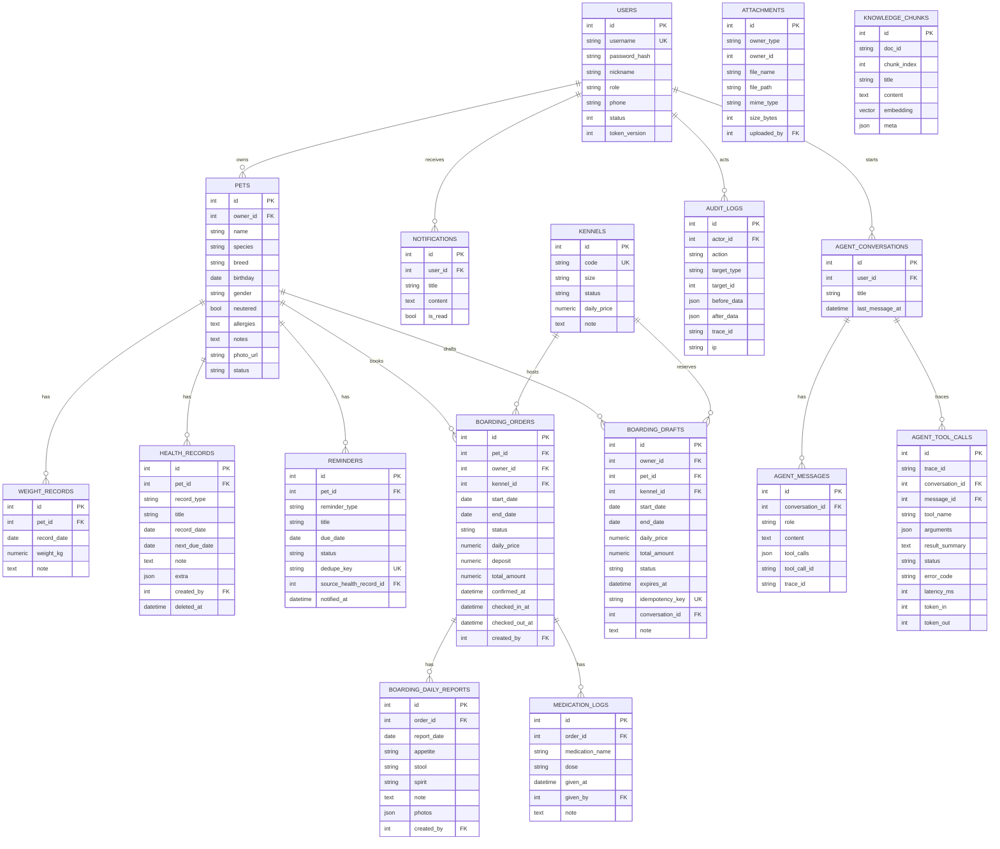

# PawCare 数据模型（ER）

> 第一版核心表。后续实现 Agent 评测时，评测用例放仓库 YAML，不建库表。

## 约束说明

- `boarding_orders` 同一 `kennel_id` 的日期区间不得重叠：MySQL 无 `EXCLUDE` 约束，由应用层档期校验在确认事务中完成，并用笼舍行锁（`SELECT … FOR UPDATE`）串行化并发确认。
- 向量列 `knowledge_chunks.embedding` 以 JSON 文本（512 维）存储，检索在应用层计算余弦相似度。
- `reminders.dedupe_key` 唯一，保证 APScheduler 重复扫描不会产生重复提醒。
- `boarding_drafts.idempotency_key` 唯一，确认接口用它防重复下单。
- 健康档案采用软删除（`deleted_at`），关键修改写 `audit_logs`。
